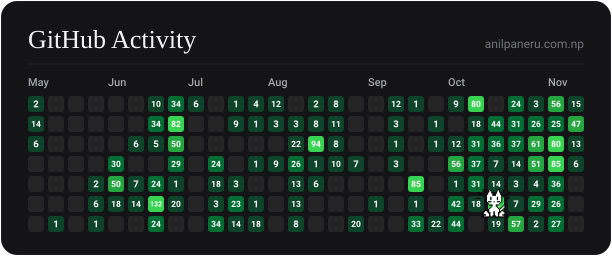

# Hi there, I'm Anil (@jstani7) 👋

<p align="left">
  <a href="https://anilpaneru.com.np" target="_blank">
    
  </a>
  <a href="https://www.linkedin.com/in/theanilpaneru/" target="_blank">
    
  </a>
  <a href="mailto:theanilpaneru@gmail.com">
    
  </a>
</p>

```python
class AIEngineer:
    def __init__(self):
        self.name = "Anil Paneru"
        self.role = "AI Engineer & LLM Developer"
        self.website = "https://anilpaneru.com.np"
        self.focus = ["Large Language Models", "Autonomous Agents", "Deep Learning"]
        self.stack = ["Python", "PyTorch", "Transformers", "LangChain", "FastAPI"]
```

---

### 👨‍💻 About Me
- 🔭 **Role**: AI Engineer building intelligent systems, autonomous agents, and production-ready ML solutions.
- 🌐 **Portfolio**: [anilpaneru.com.np](https://anilpaneru.com.np)
- 🧠 **Interests**: LLM fine-tuning, RAG pipelines, model optimization, and agentic workflows.
- ⚡ **Core Stack**: Python, PyTorch, Hugging Face, LangChain, vLLM, Docker.
- 📫 **Connect**: [LinkedIn](https://www.linkedin.com/in/theanilpaneru/) | [Email](mailto:theanilpaneru@gmail.com)

---

### 🛠️ Tech Stack & Tools


---

### 📈 GitHub Activity
<p align="center">
  <a href="https://anilpaneru.com.np">
    
  </a>
</p>

### 📊 GitHub Stats
<p align="center">
  
  
</p>
